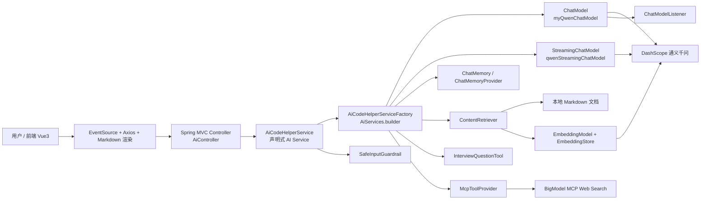
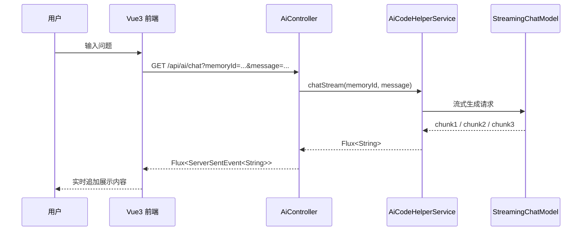
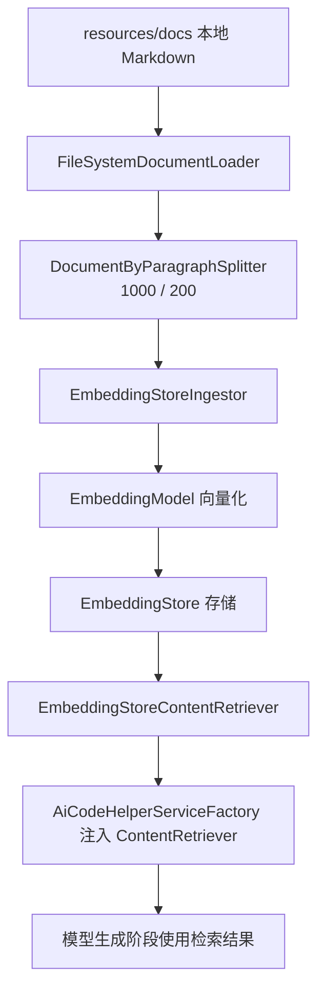

# LangChain4j 核心知识体系与 "AI 编程小助手" 实战解析

## 1. 引言

### 1.1 项目背景与技术选型理由

“AI 编程小助手” 是一个面向编程学习、技术答疑和面试求职辅导场景的智能应用。它不是一个单纯的聊天机器人，而是一个具备多轮记忆、知识检索、工具调用、外部协议扩展和流式交互能力的完整 AI 应用。

项目当前技术栈为：

- 后端：Spring Boot 4.0.4 + Java 21
- AI 框架：LangChain4j 1.1.x
- 模型提供商：通义千问 DashScope
- 协议扩展：MCP
- 检索增强：RAG
- 前端：Vue 3 + Vite

选择 **LangChain4j + Spring Boot**，而不是直接手写模型 HTTP 调用，核心原因有四点：

1. **抽象层次更高**  
   LangChain4j 提供了 `AI Services`、`Memory`、`Guardrails`、`RAG`、`Tool Calling`、`MCP` 等统一抽象，避免项目从底层 HTTP 开始堆砌。

2. **与 Spring 生态天然契合**  
   模型、检索器、工具、监听器都可以直接作为 Spring Bean 管理，适合企业项目分层与依赖注入。

3. **更适合复杂能力叠加**  
   当前项目不仅有聊天，还包括流式对话、知识检索、外部工具、输入护轨和调试监听。LangChain4j 的设计能较自然地把这些能力串起来。

4. **适合声明式开发与工程演进**  
   在本项目中，`AiCodeHelperService` 只是一个接口，但通过 `AiServices.builder()` 可以动态生成具备完整能力的服务代理。这样既保留了接口编程优势，也避免了大量样板代码。

从架构设计角度看，这个项目选择 LangChain4j，不是为了“少写几行代码”，而是为了建立一套可扩展的 AI 应用骨架。

### 1.2 整体架构图解



这个架构的关键点在于：**控制器只负责 HTTP 交互，AI 能力的真正编排发生在服务工厂层**。这使得后续扩展模型、记忆、RAG、工具调用和护轨时，不需要在 Web 层堆逻辑。

## 2. 环境搭建与核心配置

### 2.1 依赖管理 `pom.xml` 关键点

#### 通用原理

一个完整的 LangChain4j 应用通常至少需要以下几类依赖：

- Web 层能力
- 核心 LangChain4j 抽象
- 模型提供商 Starter
- 流式响应支持
- 工具调用与外部协议能力
- 可选的 HTML 解析、RAG 支持等

如果只接普通对话模型，依赖很少。但一旦引入流式输出、MCP、RAG、工具调用，依赖就会明显分层。

#### 本项目落地实现

本项目 `pom.xml` 的关键依赖如下：

```xml
<dependency>
    <groupId>org.springframework.boot</groupId>
    <artifactId>spring-boot-starter-webmvc</artifactId>
</dependency>

<dependency>
    <groupId>dev.langchain4j</groupId>
    <artifactId>langchain4j-community-dashscope-spring-boot-starter</artifactId>
    <version>1.1.0-beta7</version>
</dependency>

<dependency>
    <groupId>dev.langchain4j</groupId>
    <artifactId>langchain4j</artifactId>
    <version>1.1.0</version>
</dependency>

<dependency>
    <groupId>dev.langchain4j</groupId>
    <artifactId>langchain4j-spring-boot-starter</artifactId>
    <version>1.1.0-beta7</version>
</dependency>

<dependency>
    <groupId>dev.langchain4j</groupId>
    <artifactId>langchain4j-mcp</artifactId>
    <version>1.1.0-beta7</version>
</dependency>

<dependency>
    <groupId>dev.langchain4j</groupId>
    <artifactId>langchain4j-reactor</artifactId>
    <version>1.1.0-beta7</version>
</dependency>

<dependency>
    <groupId>org.jsoup</groupId>
    <artifactId>jsoup</artifactId>
    <version>1.20.1</version>
</dependency>
```

这里的设计决策很明确：

- `langchain4j-community-dashscope-spring-boot-starter`：负责接入通义千问生态
- `langchain4j`：提供核心抽象与 AI Service 能力
- `langchain4j-spring-boot-starter`：增强 Spring 集成
- `langchain4j-mcp`：支持 MCP 协议远程工具
- `langchain4j-reactor`：打通 `Flux` 流式输出
- `jsoup`：服务本地工具 `InterviewQuestionTool`

这不是“多加依赖”，而是围绕当前项目能力边界进行拆分。

### 2.2 多模型配置 `application.yaml` 解析

#### 通用原理

AI 应用通常不会只有一个模型。至少会出现三类：

- 普通聊天模型：适合同步问答
- 流式聊天模型：适合实时输出
- 嵌入模型：适合向量化与 RAG

把这些模型拆开配置的原因是：

- 它们职责不同
- 响应模式不同
- 成本与性能策略不同
- 后续替换时影响范围更可控

#### 本项目落地实现

本项目的核心配置片段如下：

```yaml
spring:
  application:
    name: ai-code-helper
  profiles:
    active: local

server:
  port: 8081
  servlet:
    context-path: /api

langchain4j:
  community:
    dashscope:
      chat-model:
        model-name: qwen3-max
        api-key: <You API Key here>
      embedding-model:
        model-name: text-embedding-v4
        api-key: <You API Key here>
      streaming-chat-model:
        model-name: qwen-max
        api-key: <Your Api Key here>

bigmodel:
  api-key: <Your Api Key>
```

这里体现了三个重要设计决策：

1. **聊天模型和流式模型分离**  
   普通对话走 `chat-model`，实时输出走 `streaming-chat-model`。

2. **Embedding 模型单独配置**  
   RAG 检索不是复用聊天模型，而是专门使用 `embedding-model`。

3. **MCP 独立密钥管理**  
   `bigmodel.api-key` 与 DashScope 配置解耦，便于后续替换远程 MCP 服务。

### 2.3 密钥管理与环境变量建议

#### 通用原理

模型密钥不应该直接硬编码在代码仓库里，原因包括：

- 泄露风险高
- 多环境切换困难
- CI/CD 注入不方便

更合理的做法是：

- 本地开发用 `application-local.yaml`
- 测试与生产用环境变量
- 容器部署时由外部配置中心或 Secret 管理

#### 本项目建议

建议把配置改成：

```yaml
langchain4j:
  community:
    dashscope:
      chat-model:
        model-name: qwen3-max
        api-key: ${DASHSCOPE_CHAT_API_KEY}
      embedding-model:
        model-name: text-embedding-v4
        api-key: ${DASHSCOPE_EMBEDDING_API_KEY}
      streaming-chat-model:
        model-name: qwen-max
        api-key: ${DASHSCOPE_STREAM_API_KEY}

bigmodel:
  api-key: ${BIGMODEL_API_KEY}
```

这样设计的好处是：

- 开发、测试、生产环境隔离
- 降低密钥泄露风险
- 更适合后续接入 Codex、CI 和容器部署

## 3. 核心组件深度解析（理论 + 项目实战）

### 3.1 AI Services 声明式开发

#### 通用原理

LangChain4j 的 `AI Services` 提供了一种非常适合 Java 开发者的模式：**用接口定义 AI 能力，用动态代理生成实现**。

相比手动拼请求：

- 接口更清晰
- 提示词更集中
- 参数绑定更自然
- 更容易叠加记忆、工具、护轨、RAG

适合中大型项目的原因在于，AI 能力不再是散落在业务代码中的 HTTP 请求，而是被封装成一个“面向领域的服务接口”。

#### 本项目落地实现

项目中的核心接口是 `AiCodeHelperService`：

```java
@InputGuardrails(SafeInputGuardrail.class)
public interface AiCodeHelperService {

    @SystemMessage(fromResource = "system-prompt.txt")
    String chat(String userMessage);

    @SystemMessage(fromResource = "system-prompt.txt")
    Report chatForReport(String userMessage);

    @SystemMessage(fromResource = "system-prompt.txt")
    Result<String> chatWithRag(String userMessage);

    @SystemMessage(fromResource = "system-prompt.txt")
    Flux<String> chatStream(@MemoryId int memoryId, @UserMessage String userMessage);

    record Report(String name, List<String> suggestionList) {}
}
```

这段代码的价值在于：

- 接口名称和业务语义绑定
- 提示词通过注解声明
- 会话记忆通过 `@MemoryId` 显式建模
- 用户消息通过 `@UserMessage` 标识
- 护轨在接口层统一接入

真正的服务实例则在 `AiCodeHelperServiceFactory` 中构建：

```java
@Bean
public AiCodeHelperService aiCodeHelperService(McpToolProvider mcpToolProvider) {
    ChatMemory chatMemory = MessageWindowChatMemory.withMaxMessages(10);

    return AiServices.builder(AiCodeHelperService.class)
            .chatModel(myQwenChatModel)
            .streamingChatModel(qwenStreamingChatModel)
            .chatMemory(chatMemory)
            .chatMemoryProvider(memoryId ->
                    MessageWindowChatMemory.withMaxMessages(10))
            .contentRetriever(contentRetriever)
            .tools(new InterviewQuestionTool())
            .toolProvider(mcpToolProvider)
            .build();
}
```

这体现了一个关键设计思想：**接口声明能力边界，工厂装配能力实现**。  
这么设计的优势是：

- 接口层不关心模型提供商细节
- 配置集中在工厂层
- 替换模型、记忆策略、工具、RAG 时不会污染业务接口

### 3.2 提示词管理系统

#### 通用原理

在生产级 AI 应用中，Prompt 不应直接写死在 Controller 或 Service 实现中。更合理的做法是：

- 外部资源文件管理
- 支持分版本演进
- 与业务代码解耦

Few-shot、角色设定、输出格式要求、本地业务规则，本质上都属于提示词系统的一部分。

#### 本项目落地实现

本项目使用：

```java
@SystemMessage(fromResource = "system-prompt.txt")
```

这意味着系统提示词存放在：

- `src/main/resources/system-prompt.txt`

LangChain4j 在运行时会自动从 classpath 中加载该资源，并把它作为系统消息注入模型调用链。

这种做法相比直接写字符串更合理，原因是：

- 修改提示词无需重新改业务逻辑
- 更适合多人协作
- 可以逐步演进为 Prompt 版本管理

#### Few-Shot 在本项目中的应用建议

当前项目主要使用的是统一系统提示词，还没有明显引入 Few-shot 模板。但从业务角度看，以下场景适合加入 Few-shot：

- 输出学习路线时，给出标准示例格式
- 输出面试报告时，给出结构化示例
- 输出工具调用结果时，约束模型总结风格

例如可以在 `system-prompt.txt` 中补充示例：

```text
示例：
用户问题：我想学习 Java 后端
参考输出：
1. 先掌握 Java 基础与集合框架
2. 再学习并发编程与 JVM
3. 然后学习 Spring Boot 与数据库
4. 最后结合项目实践与面试准备
```

设计上这么做的原因是：**Few-shot 不是为了“多写提示词”，而是为了让模型输出更稳定、更符合团队预期格式。**

### 3.3 多轮对话记忆

#### 通用原理

多轮对话的关键不是“保存所有历史消息”，而是“在成本、上下文长度和效果之间做平衡”。

常见策略有：

- 全量记忆
- 窗口记忆
- 摘要记忆
- 基于用户 ID / 会话 ID 隔离

在大多数业务系统中，最先落地的是 **窗口记忆 + 会话隔离**。

#### 本项目落地实现

项目使用 `memoryId` 做会话隔离，接口方法如下：

```java
Flux<String> chatStream(@MemoryId int memoryId, @UserMessage String userMessage);
```

工厂中配置了两类记忆：

```java
ChatMemory chatMemory = MessageWindowChatMemory.withMaxMessages(10);

.chatMemory(chatMemory)
.chatMemoryProvider(memoryId ->
        MessageWindowChatMemory.withMaxMessages(10))
```

这里的核心思想是：

- `memoryId` 代表一个独立会话
- `chatMemoryProvider` 为不同会话动态提供独立的窗口记忆
- 每个窗口最多保留 10 条消息

虽然当前实现里 `memoryId` 还没有接入数据库或缓存层做持久化，但已经具备了“会话级上下文隔离”的基本架构。

#### 为什么用 `MessageWindowChatMemory`

原因很现实：

- 实现简单
- 成本可控
- 足以支撑短会话编程辅导场景

如果直接用全量记忆，会导致：

- Token 成本快速上升
- 长会话延迟增加
- 模型上下文污染风险提高

因此当前方案适合作为第一阶段实现。后续如果要支持长对话，可以演进为：

- Redis 存储对话历史
- 摘要记忆压缩上下文
- 基于用户维度持久化 `memoryId`

### 3.4 流式响应全链路

#### 通用原理

流式响应的目标不是“让后端更复杂”，而是提升用户体验。对 AI 问答系统来说，边生成边展示通常比等待完整结果后一次性返回更自然。

一个完整的流式链路通常包括：

1. 流式模型输出 token 或 chunk
2. 后端封装为响应流
3. 浏览器持续消费流
4. 前端逐步拼接显示

#### 本项目落地实现

项目链路如下：

- 模型层：`StreamingChatModel`
- 服务层：`Flux<String>`
- 控制器层：`Flux<ServerSentEvent<String>>`
- 前端层：`EventSource`

控制器实现如下：

```java
@RequestMapping(value = "/chat", produces = "text/event-stream;charset=UTF-8")
public Flux<ServerSentEvent<String>> chat(int memoryId, String message) {
    return aiCodeHelperService.chatStream(memoryId, message)
            .map(chunk -> ServerSentEvent.<String>builder()
                    .data(chunk)
                    .build());
}
```

前端则通过 `EventSource` 持续接收：

```javascript
const stream = new EventSource(buildChatStreamUrl(memoryId.value, text))

stream.onmessage = (event) => {
  messages.value[assistantIndex].content += event.data
}
```

#### 流式链路流程图



#### 设计决策分析

这么设计的原因有三点：

1. **后端对前端协议友好**  
   使用标准 SSE，浏览器原生支持，不必引入 WebSocket。

2. **服务层和控制器层职责分离**  
   Service 只关心 `Flux<String>`，Controller 才负责转为 SSE。

3. **便于排查问题**  
   如果流断了，可以判断问题发生在模型层、Reactor 层还是 SSE 层。

## 4. 高级能力实战

### 4.1 RAG 检索增强

#### 通用原理

RAG 的核心思想是：**先检索，再生成**。  
它的目的不是替代大模型，而是给大模型提供更贴近业务语境的外部知识。

典型流程是：

1. 准备知识源文档
2. 文档切片
3. 文本向量化
4. 存入向量库
5. 用户提问时把问题向量化
6. 检索相似文档片段
7. 将检索结果拼入模型上下文

#### 本项目落地实现

本项目的 `RagConfig` 就是完整 RAG 管线的实现。

关键代码：

```java
List<Document> documents = FileSystemDocumentLoader.loadDocuments("src/main/resources/docs");

DocumentByParagraphSplitter documentByParagraphSplitter =
        new DocumentByParagraphSplitter(1000, 200);

EmbeddingStoreIngestor ingestor = EmbeddingStoreIngestor.builder()
        .documentSplitter(documentByParagraphSplitter)
        .textSegmentTransformer(textSegment -> TextSegment.from(
                textSegment.metadata().getString("file_name") + "\n" + textSegment.text(),
                textSegment.metadata()))
        .embeddingModel(qwenEmbeddingModel)
        .embeddingStore(embeddingStore)
        .build();

ingestor.ingest(documents);

EmbeddingStoreContentRetriever contentRetriever =
        EmbeddingStoreContentRetriever.builder()
                .embeddingStore(embeddingStore)
                .embeddingModel(qwenEmbeddingModel)
                .maxResults(5)
                .minScore(0.75)
                .build();
```

#### 本地知识库构建流程



#### 为什么采用段落切分

项目使用：

```java
new DocumentByParagraphSplitter(1000, 200)
```

这背后有明确设计考虑：

- 按段落比按固定长度切割更符合文档语义
- `1000` 字符足够保留一段完整说明
- `200` 重叠可以降低语义断裂风险

这是一个比较适合 Markdown 知识文档的切分策略。

#### 为什么加 `file_name`

项目在 `textSegmentTransformer` 里把文件名拼到片段前面：

```java
textSegment.metadata().getString("file_name") + "\n" + textSegment.text()
```

这么设计的好处是：

- 检索出来的片段带有来源上下文
- 模型更容易理解知识片段属于哪类文档
- 回答时更容易保留文档主题一致性

#### 检索优化参数

项目当前配置：

- `maxResults(5)`
- `minScore(0.75)`

设计意图是：

- 最多取 5 条，避免上下文过长
- 相似度低于 0.75 的结果不纳入生成，减少噪声

这是一组偏保守的阈值，更适合“答案质量优先”的学习辅导场景。

### 4.2 工具调用生态

#### 通用原理

工具调用的本质是：**让模型不再只依赖参数化记忆，而是能够委托外部系统执行具体动作**。

LangChain4j 中，工具大致分为两类：

1. 本地 Java 工具
2. 远程协议工具，例如 MCP

这两类工具都能被模型调用，但设计侧重点不同。

#### 本项目的本地 Java 工具

`InterviewQuestionTool` 使用 `@Tool` 注解声明：

```java
@Tool(name = "interviewQuestionSearch", value = """
        Retrieves relevant interview questions from mianshiya.com based on a keyword.
        """)
public String searchInterviewQuestions(@P(value = "the keyword to search") String keyword) {
    ...
}
```

这里的机制是：

- 模型决定是否调用工具
- LangChain4j 自动解析参数
- Java 方法执行后返回结果
- 结果重新喂给模型生成最终答案

适用场景：

- 项目内已有逻辑
- 执行链路简单
- 数据源是可控的本地逻辑或轻量外部抓取

#### 本项目的 MCP 远程工具

`McpConfig` 通过 `HttpMcpTransport` 接入远程 Web Search：

```java
McpTransport transport = new HttpMcpTransport.Builder()
        .sseUrl("https://open.bigmodel.cn/api/mcp/web_search/sse?Authorization=" + apiKey)
        .logRequests(true)
        .logResponses(true)
        .build();
```

再构建：

```java
McpToolProvider toolProvider = McpToolProvider.builder()
        .mcpClients(mcpClient)
        .build();
```

适用场景：

- 需要接第三方能力
- 工具由外部系统维护
- 希望用协议解耦，而不是手写每个工具方法

#### 本地工具 vs MCP 工具对比

| 维度 | 本地 Java 工具 | MCP 远程工具 |
|---|---|---|
| 实现位置 | 项目内部 | 外部服务 |
| 延迟 | 通常较低 | 依赖网络 |
| 可控性 | 高 | 中 |
| 扩展成本 | 需要写代码 | 协议接入后可复用 |
| 适用场景 | 规则清晰、本地逻辑 | 搜索、外部系统能力 |

设计上这么做的原因不是“多一种工具形式”，而是为了建立分层能力体系：

- 本地工具负责强业务定制
- MCP 负责外部能力接入

### 4.3 智能体与安全

#### 通用原理

AI 应用并不只关心“模型能回答什么”，还要考虑“模型不该回答什么”。  
Guardrails 的本质就是在调用链中增加拦截层，用于提前筛除不安全输入。

#### 本项目落地实现

项目的输入护轨是 `SafeInputGuardrail`：

```java
public class SafeInputGuardrail implements InputGuardrail {

    private static final Set<String> sensitiveWords = Set.of("kill", "evil");

    @Override
    public InputGuardrailResult validate(UserMessage userMessage) {
        String inputText = userMessage.singleText().toLowerCase();
        String[] words = inputText.split("\\W+");
        for (String word : words) {
            if (sensitiveWords.contains(word)) {
                return fatal("Sensitive word detected: " + word);
            }
        }
        return success();
    }
}
```

它通过：

```java
@InputGuardrails(SafeInputGuardrail.class)
```

挂到 `AiCodeHelperService` 上。

#### 拦截逻辑分析

调用链顺序可以理解为：

1. Controller 收到请求
2. 调用 `AiCodeHelperService`
3. 护轨先校验用户输入
4. 校验通过才进入模型调用
5. 模型执行记忆、工具、RAG 等后续流程

这么设计的价值在于：

- 把风险拦在模型之前
- 降低模型成本浪费
- 避免不安全输入进入工具调用链

#### 异常处理策略建议

当前项目护轨逻辑已经具备基础能力，但如果面向生产，建议补充：

- 统一异常转换
- 对护轨失败返回业务可读错误码
- 对工具异常进行降级包装
- 对 MCP 超时或断流设置 fallback

## 5. 可观测性与调试

### 5.1 `ChatModelListener` 的实现与日志分析

#### 通用原理

AI 应用的一个典型难点在于：  
明明接口调用成功了，但输出不符合预期。  
这类问题如果没有请求、响应、异常级别的可观测性，排查会非常低效。

LangChain4j 的 `ChatModelListener` 提供了一个重要切入点，可以在模型调用前后记录关键信息。

#### 本项目落地实现

```java
@Bean
ChatModelListener chatModelListener() {
    return new ChatModelListener() {
        @Override
        public void onRequest(ChatModelRequestContext requestContext) {
            log.info("onRequest(): {}", requestContext.chatRequest());
        }

        @Override
        public void onResponse(ChatModelResponseContext responseContext) {
            log.info("onResponse(): {}", responseContext.chatResponse());
        }

        @Override
        public void onError(ChatModelErrorContext errorContext) {
            log.info("onError(): {}", errorContext.error().getMessage());
        }
    };
}
```

该监听器随后挂载到聊天模型：

```java
@Bean
public ChatModel myQwenChatModel() {
    return QwenChatModel.builder()
            .apiKey(apiKey)
            .modelName(modelName)
            .listeners(List.of(chatModelListener))
            .build();
}
```

#### 为什么这么设计

1. **模型行为可追踪**  
   可以看到最终送入模型的请求内容。

2. **便于判断问题边界**  
   是 Prompt 问题、模型响应问题，还是工具或 RAG 注入导致的异常，可以更快区分。

3. **后续可扩展到监控体系**  
   例如埋点延迟、失败率、响应长度等指标。

### 5.2 常见报错排查指南

#### 场景一：RAG 依赖缺失导致 Spring 启动失败

典型现象：

- `ContentRetriever` Bean 找不到
- `EmbeddingStore` Bean 缺失
- 测试类 `@SpringBootTest` 全部失败

根因分析：

- `AiCodeHelperServiceFactory` 强依赖 `ContentRetriever`
- `ContentRetriever` 由 `RagConfig` 提供
- 如果 `RagConfig` 没注册、`EmbeddingModel` 配置缺失，或 `EmbeddingStore<TextSegment>` 没有装配，整个上下文启动都会失败

排查顺序建议：

1. 确认 `RagConfig` 是否被 Spring 扫描
2. 确认 `embedding-model` 配置是否生效
3. 确认 `EmbeddingStore<TextSegment>` 是否存在 Bean
4. 确认 `AiCodeHelperServiceFactory` 是否强依赖该检索器

#### 场景二：中文参数导致接口 `400`

典型现象：

- `GET /api/ai/chat` 返回 `400 Bad Request`
- Tomcat 日志包含 `Character decoding failed`

根因分析：

- Git Bash 或某些终端对中文参数编码不一致
- `message` 查询参数在进入 Controller 前就解码失败

建议：

- 优先用前端页面、Apifox 或 Postman 测试
- 命令行场景使用 URL 编码后的中文参数
- Controller 参数建议显式加 `@RequestParam`

#### 场景三：MCP 频繁重连

典型日志：

- `Trying to reconnect...`

根因分析：

- 远程 SSE 服务不稳定
- 网络波动
- Token 或权限问题

建议：

- 检查 `bigmodel.api-key`
- 打开请求响应日志
- 对 MCP 工具调用设置超时和容错策略

## 6. 扩展与最佳实践

### 6.1 如何新增一个工具

#### 通用原理

新增工具时，建议遵循三个原则：

- 工具职责单一
- 输入参数清晰
- 返回结果尽量结构化或可总结

#### 本项目推荐做法

新增一个本地工具的步骤：

1. 在 `ai/tools` 包下新增工具类
2. 使用 `@Tool` 标记方法
3. 在 `AiCodeHelperServiceFactory` 中通过 `.tools(...)` 注册

示例：

```java
public class LearningRouteTool {

    @Tool(name = "learningRouteSuggest", value = "Suggests a learning route by topic")
    public String suggest(@P("topic") String topic) {
        return "建议从基础语法、核心框架、项目实践和面试准备四个阶段学习 " + topic;
    }
}
```

工厂中注册：

```java
.tools(new InterviewQuestionTool(), new LearningRouteTool())
```

为什么推荐这种方式：

- 与当前项目风格一致
- 便于单独测试
- 不依赖外部协议

### 6.2 如何切换模型提供商

#### 通用原理

切换模型提供商不应直接修改业务接口，而应通过配置层与 Bean 层完成。

#### 本项目演进建议

当前项目已经把聊天模型独立到了 `QwenChatModelConfig`。要切换模型提供商，可以继续沿用这个思路：

1. 新增新的配置类，例如 `OpenAiChatModelConfig`
2. 保持对外暴露 `ChatModel` Bean
3. 尽量不改 `AiCodeHelperService` 和 `AiCodeHelperServiceFactory` 的业务接口设计

如果要进一步抽象，建议：

- 抽象出 `ChatModel`、`StreamingChatModel`、`EmbeddingModel` 的统一装配规范
- 使用 profile 区分不同提供商

这样设计的好处是：**AI 应用的核心业务应该依赖 LangChain4j 抽象，而不是依赖某个厂商 SDK 的细节。**

### 6.3 生产环境部署建议

#### 性能建议

- 对 RAG 索引构建做启动预热，避免首次请求时现场 ingest
- 对高频工具调用做限流与缓存
- 对流式接口配置合理超时
- 在会话数增多时引入外部记忆存储

#### 安全建议

- 所有 API Key 走环境变量或 Secret 管理
- 护轨策略不要只停留在敏感词
- 对工具调用增加白名单和超时保护
- 对外部 MCP 服务增加降级兜底

#### 稳定性建议

- 对模型响应、工具异常、RAG 注入失败做统一异常包装
- 增加调用链日志 traceId
- 引入调用耗时与失败率监控

## 7. 附录

### 7.1 核心类速查表

| 类名 | 作用 | 说明 |
|---|---|---|
| `AiCodeHelperService` | 声明式 AI 服务接口 | 定义聊天、报告、RAG、流式接口 |
| `AiCodeHelperServiceFactory` | AI 服务装配中心 | 用 `AiServices.builder()` 构建代理 |
| `QwenChatModelConfig` | 普通聊天模型配置 | 创建 `ChatModel` 并挂接监听器 |
| `RagConfig` | RAG 检索配置 | 文档加载、切分、向量化、检索器生成 |
| `McpConfig` | MCP 工具配置 | 接入远程 Web Search 工具 |
| `InterviewQuestionTool` | 本地工具实现 | 面试题搜索工具 |
| `SafeInputGuardrail` | 输入护轨 | 敏感词校验 |
| `ChatModelListenerConfig` | 模型监听器配置 | 记录请求、响应、错误 |
| `AiController` | Web 接口入口 | 暴露 `/api/ai/chat` SSE 接口 |
| `CorsConfig` | 跨域配置 | 允许前端开发环境访问 |

### 7.2 项目目录结构说明

```text
src/main/java/com/example/aicodehelper
├─ AiCodeHelperApplication.java
└─ ai
   ├─ AiCodeHelper.java
   ├─ AiCodeHelperService.java
   ├─ AiCodeHelperServiceFactory.java
   ├─ config
   │  └─ CorsConfig.java
   ├─ contrroller
   │  └─ AiController.java
   ├─ guardrail
   │  └─ SafeInputGuardrail.java
   ├─ listener
   │  └─ ChatModelListenerConfig.java
   ├─ mcp
   │  └─ McpConfig.java
   ├─ model
   │  └─ QwenChatModelConfig.java
   ├─ rag
   │  └─ RagConfig.java
   └─ tools
      └─ InterviewQuestionTool.java

src/main/resources
├─ application.yaml
├─ application-local.yaml
├─ system-prompt.txt
└─ docs
   ├─ Java 编程学习路线.md
   ├─ 程序员常见面试题.md
   ├─ 鱼皮的求职指南.md
   └─ 鱼皮的项目学习建议.md

ai-code-helper-frontend
├─ src/App.vue
├─ src/lib/api.js
├─ src/main.js
└─ src/styles.css
```

该结构的优点是模块职责清晰，适合团队协作和逐步扩展。尤其对后续接入 AI 编码助手或进行工程化治理时，能够快速定位模型配置、RAG、MCP、工具和 Web 层的边界。

### 7.3项目启动方式

#### 启动后端

在项目根目录执行：

```bash
mvn spring-boot:run
```

或者使用 IDEA 直接运行 Spring Boot 主类。

#### 启动前端

进入前端目录：

```bash
cd D:\code\ai-code-helper\ai-code-helper-frontend
npm.cmd install
npm.cmd run dev
```

#### 访问地址

- 前端：`http://localhost:5173`
- 后端：`http://localhost:8081/api`

---

